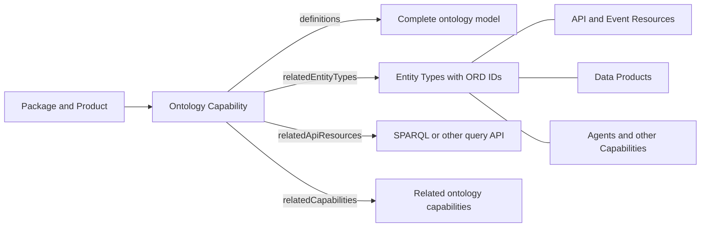

# Ontologies and Entity Types

An ontology is a coherent semantic model of domain concepts, their relationships, and their formal meaning.
ORD represents this model through two complementary layers: individually addressable [Entity Types](../interfaces/Document#entity-type) and an [Ontology Capability](../interfaces/Document#capability) that describes the model as a whole.

## Two complementary layers

### Entity Types

An Entity Type represents a significant domain concept or business term, such as a Workforce Person, Work Agreement, or Cost Center.
Publishing the concept as an Entity Type gives it a stable ORD ID that other ORD resources can reference independently.
An ORD ID is globally unique at design time unless it uses a customer-scoped namespace, and runtime identity additionally depends on the system context.

Entity Types make the domain concepts addressable in the ORD graph.
API Resources, Event Resources, Data Products, Agents, and Capabilities can use these identifiers to state which concepts they expose, contain, process, or otherwise relate to.

An Entity Type can provide `definitions` that describe its own internal model or aggregate.
Such a definition is scoped to that individual Entity Type and is not a container for an entire multi-entity ontology.

### Ontology Capabilities

An Ontology Capability is a Capability with `type: "ontology"`.
It gives the ontology itself an ORD identity, lifecycle, ownership context, visibility, and machine-readable definitions.

The Capability definition describes the complete ontology or semantic domain model as one coherent artifact.
It can preserve relationships that would be lost if the model were split into separate files for every Entity Type.
It can also contain semantic elements that are not published as Entity Types, including properties, predicates, axioms, classifications, constraints, and references to external concepts or vocabularies.

Not every class or concept in an ontology needs to become an ORD Entity Type.
Publishers SHOULD create Entity Types for the concepts that need to be discovered or referenced independently by other ORD resources.
The Ontology Capability SHOULD list the Entity Types represented in its model through `relatedEntityTypes`.

### Why publish both?

Entity Types and an Ontology Capability solve different discovery problems.

- Entity Types let consumers find and reference individual domain concepts by ORD ID.
- The Ontology Capability lets consumers retrieve and interpret the complete semantic model, including relationships and additional ontology elements.
- Shared Entity Type references connect the ontology to APIs, Events, Data Products, Agents, and other Capabilities without duplicating the ontology definition on each resource.



## Relationships to other ORD concepts

The Ontology Capability acts as the catalog entry for the complete semantic model, while Entity Types connect that model to the rest of ORD.

| ORD concept | Relationship to Entity Types and the ontology |
| --- | --- |
| [Package and Product](./grouping-and-bundling.md) | The Ontology Capability and its Entity Types use `partOfPackage` and optionally `partOfProducts` to express ownership and product context. |
| [API Resource](../interfaces/Document#api-resource) | An API can identify the Entity Types it exposes. An API that provides SPARQL or another query protocol can be linked from the Ontology Capability through `relatedApiResources`. |
| [Event Resource](../interfaces/Document#event-resource) | An Event Resource can identify Entity Types represented by its payloads, connecting event contracts to the shared semantic model. |
| [Data Product](./data-product.md) | A Data Product can list the Entity Types in its data set. Consumers can follow those ORD IDs to the ontology that supplies their broader semantic context. |
| [Agent](./ai-agents-and-protocols.md) | An Agent can use `relatedEntityTypes` to identify the domain concepts it operates on. Those same Entity Types connect the Agent to the ontology. |
| Other Capabilities | A Capability can use `relatedEntityTypes` for domain context. An Ontology Capability can use `relatedCapabilities` for catalog-level relationships to another ontology or semantic capability. |
| [Groups](./grouping-and-bundling.md#groups) | The Ontology Capability and Entity Types can use `partOfGroups` for governed classification or navigation. Groups do not replace semantic relationships expressed by the ontology itself. |
| [Integration Dependencies](./integration-dependency.md) | Integration Dependencies describe resources required at runtime. Ontology imports and references belong in the ontology definition and SHOULD NOT be modeled as Integration Dependencies solely because one ontology refers to another. |

There is no direct Ontology Capability relationship to Data Products or Agents.
Their shared Entity Type ORD IDs provide the semantic connection and avoid duplicating relationship properties for every resource combination.

## Entity Type definitions and ontology definitions

The two definition locations have different scopes.

| Definition location | Scope | Typical content |
| --- | --- | --- |
| `entityTypes[].definitions` | One Entity Type or aggregate | The structure, properties, or implementation-oriented model of the individual Entity Type |
| `capabilities[type=ontology].definitions` | The complete ontology or semantic domain model | Multiple concepts, their relationships, formal semantics, ontology metadata, and external references |

When both forms are published, they SHOULD describe consistent semantics.
Concatenating individual Entity Type definitions does not necessarily reconstruct the complete ontology.
The whole-model definition preserves relationships and ontology elements that are not represented by individual Entity Types.

## Definition type and serialization

The definition `type` identifies the semantic language or model format.
The `mediaType` identifies the concrete serialization that a consumer must parse.

| Definition `type` | Meaning | Example `mediaType` values |
| --- | --- | --- |
| `rdf-v1.1` | Generic [RDF 1.1](https://www.w3.org/TR/rdf11-concepts/) graph | `application/ld+json`, `text/turtle`, `application/rdf+xml`, `application/n-triples` |
| `rdfs-v1.1` | [RDF Schema 1.1](https://www.w3.org/TR/rdf-schema/) vocabulary | `application/ld+json`, `text/turtle`, `application/rdf+xml`, `application/n-triples` |
| `owl-v2` | [OWL 2](https://www.w3.org/TR/owl2-overview/) ontology represented as an RDF graph | `application/ld+json`, `text/turtle`, `application/rdf+xml`, `application/n-triples` |
| `sap-csn-interop-effective-v1` | [CSN Interop Effective](https://sap.github.io/csn-interop-specification/) domain model export | `application/json` |

Publishers MAY provide more than one serialization of the same definition.
Each entry uses the same `type` and a different `mediaType`.
Consumers can then select a serialization they support.

## Example

The following excerpt publishes two independently addressable Entity Types and one Ontology Capability that covers both concepts as a complete model.
The optional Entity Type definition is scoped to Workforce Person, while both Capability definitions serialize the entire workforce ontology.

```json
{
  "entityTypes": [
    {
      "ordId": "example:entityType:WorkforcePerson:v1",
      "localId": "WorkforcePerson",
      "level": "root-entity",
      "title": "Workforce Person",
      "version": "1.0.0",
      "releaseStatus": "active",
      "visibility": "public",
      "partOfPackage": "example:package:workforce:v1",
      "definitions": [
        {
          "type": "example:entity-model:v1",
          "mediaType": "application/json",
          "url": "/entity-types/workforce-person.json"
        }
      ]
    },
    {
      "ordId": "example:entityType:WorkAgreement:v1",
      "localId": "WorkAgreement",
      "level": "root-entity",
      "title": "Work Agreement",
      "version": "1.0.0",
      "releaseStatus": "active",
      "visibility": "public",
      "partOfPackage": "example:package:workforce:v1"
    }
  ],
  "capabilities": [
    {
      "ordId": "example:capability:workforceOntology:v1",
      "title": "Workforce Ontology",
      "type": "ontology",
      "version": "1.0.0",
      "releaseStatus": "active",
      "visibility": "public",
      "partOfPackage": "example:package:workforce:v1",
      "relatedEntityTypes": [
        "example:entityType:WorkforcePerson:v1",
        "example:entityType:WorkAgreement:v1"
      ],
      "definitions": [
        {
          "type": "owl-v2",
          "mediaType": "application/ld+json",
          "url": "/ontologies/workforce.jsonld"
        },
        {
          "type": "owl-v2",
          "mediaType": "text/turtle",
          "url": "/ontologies/workforce.ttl"
        }
      ]
    }
  ]
}
```

## Mapping Entity Types to ontology concepts

`relatedEntityTypes` establishes that the Entity Types are represented in the ontology, but it does not identify the corresponding class or concept inside the ontology definition.
Publishers SHOULD make this mapping unambiguous in the definition, for example through an ontology annotation or a documented identifier convention.
ORD does not currently standardize the annotation predicate or a separate ORD property for mapping an Entity Type ORD ID to an ontology IRI.
Consumers MUST NOT infer the mapping from similar titles or local identifiers alone.

## SPARQL access

[SPARQL 1.1](https://www.w3.org/TR/sparql11-query/) is a query language for RDF data, not an ontology definition or RDF serialization.
A SPARQL service endpoint SHOULD therefore be published as an API Resource with an appropriate API protocol Specification ID.
The Ontology Capability can reference that API Resource through `relatedApiResources`.
