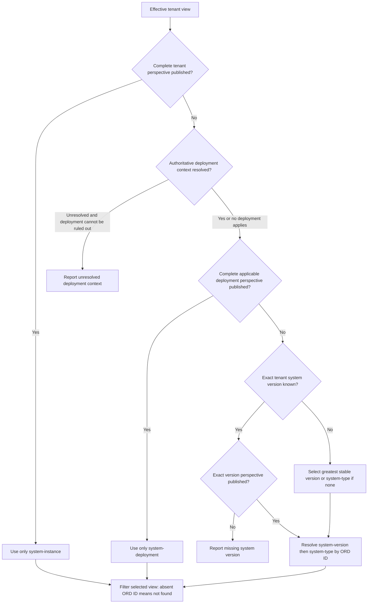

import { PerspectiveResolutionSummaryDiagram } from "@site/src/components/OrdDiagrams";

# Perspectives

> ⏩ The technical requirements of this are described in the [specification section on perspectives](../../spec-v1/index.md#perspectives).

> **Visual walkthrough:** The [perspective resolution decision flow](https://open-resource-discovery.github.io/presentation/perspective-resolution) in the ORD presentation covers the existing static and tenant perspectives.
> The alpha deployment step is specified in the updated diagrams and resolution algorithm below.

## Overview

An application or service can be described both from a [static](../../spec-v1/index.md#static-perspective) or a [dynamic](../../spec-v1/index.md#dynamic-perspective) perspective. The configuration endpoint can point to different ORD documents that represent the information from the different perspectives.
In this article, a **perspective** groups provider-published ORD documents as described under [Identifying a Perspective](#identifying-a-perspective).
An effective **view** is the result that an aggregator exposes after selecting a `system-instance` or `system-deployment` perspective or composing the applicable static perspectives by ORD ID.
The selected `system-version` and `system-type` perspectives are called layers when explaining that static composition.

> **Consumer principle:** Consumers request an effective view of a tenant or system without needing to know how an ORD provider publishes the underlying metadata.
> For a tenant, the effective view uses its `system-instance` perspective or its complete `system-deployment` perspective when no tenant perspective is published, and otherwise the applicable static fallback.
> For static metadata, a consumer can request a specific system version or the latest effective static view.
> The aggregator composes the effective static view by looking up each ORD ID in the selected `system-version` layer first and then in the `system-type` layer.
> It selects one complete representation for each ORD ID and never merges properties from the two layers.

### Static Perspective

The static perspective describes how an application or service looks like _in general_ at design-time.
This perspective is especially useful for customers, who haven't purchased a product yet and need to understand what technical capabilities they would get.
It also helps to understand the common baseline of what all systems of the same type provide and how it changes over time.
Static ORD documents MUST NOT contain tenant context or tenant-specific customizations.

The static perspective has two publication options:

- **`system-version`**: Describes static metadata associated with a specific version of a [system type](../../spec-v1/index.md#system-type).
  Use this for metadata that can differ between system versions.
- **`system-type`**: Describes version-independent static metadata for a system type without distinguishing [system versions](../../spec-v1/index.md#system-version).
  Use this for metadata that applies to every system version.

A system type MAY publish static metadata through either perspective or both.
Each ORD ID in either perspective MUST have a complete resource or taxonomy representation.
The effective static view is the union of the applicable `system-version` and `system-type` layers by ORD ID.
When the same ORD ID appears in both layers, the complete `system-version` representation takes precedence and its properties MUST NOT be merged with the `system-type` representation.
See [ORD Provider Considerations](#ord-provider-considerations) for the complete selection guidance.

The static perspective describes the shared metadata of all system instances (tenants) of the same system version or version independent.
The metadata describes only what is generic and shared, independently of tenant-specific extensibility, configuration, and feature toggles.
The advantage of static metadata is that it can be published and aggregated without first provisioning tenants. It is also a good integration contract for everything that is meant to work potentially with _any_ tenant.

At SAP, we have the [SAP Business Accelerator Hub](https://api.sap.com/) that documents the static perspective.

#### System Version Guidelines

System versioning and lifecycle management are often difficult. Putting a version on a system is not always straightforward.
Here are some guidelines how to choose the correct version for the `system-version` perspective:

- If the system has explicit versions (e.g. "v1.0.1", "v2.0.0"), use these versions.
- If the system does not use SemVer, it has to be converted so that SemVer conventions apply (conservatively).
  - E.g. if the system uses simple incremental versions like "1", "2" or "2404", convert these to "1.0.0", "2.0.0", "2404.0.0" respectively.
  - E.g. if the system uses date-based versions like "2024-01-15", convert these to "2024.1.15".
- If the system is continuously delivered and treating every system instance as running the latest effective static view is sufficient, use `system-type` or use `system-version` with a fixed version such as `1.0.0`.
  When using a fixed system version, keep `describedSystemVersion.version` unchanged and replace the published `system-version` perspective with every release.
- If multiple versions of the same application are deployed at the same time in one environment tier, such as production, use distinct `system-version` values for those releases.

For the normative rules on choosing between `system-type` and `system-version`, see [Correct Use of Perspectives](../../spec-v1/index.md#correct-use-of-perspectives).

### Dynamic Perspective

The dynamic perspective describes an application or service as it really looks like, _at run-time_.
This is more precise than the static perspective, because it can reflect configuration, customization and extensions of the system instance (tenant).

ORD has two dynamic publication scopes: `system-instance` for one tenant and the alpha `system-deployment` perspective for runtime metadata shared by all tenants of a deployment.

The `system-instance` perspective is the correct choice when the resource description or its metadata is actually different between system instances of the same system version.
When used, the perspective completely describes the running system instance as it is.
It is not a "diff" on the static perspective, for this we may consider introducing a specialized `system-instance-delta` perspective as optimization later.

Some examples when metadata can be dynamic:

- APIs or Events can be activated and deactivated per system instance / tenant.
- API or Event interfaces can be extended, e.g. through field extensibility.
- New resources can be created by the user of the application at run-time (typical situation for frameworks, platforms and extensible applications).
- Endpoint URLs may be dynamic.

At SAP, the run-time discovery of dynamic metadata (system-instance) is handled by the [Unified Metadata Service](../../introduction.mdx#dynamic-view-unified-metadata-service) in BTP.

#### System-Deployment Perspective (Alpha)

A `system-deployment` perspective describes one running deployment completely, including its shared configuration, extensions, active resources, and endpoints.
It is appropriate when these differ between deployments, including on-premise installations of the same system version, but are identical across all tenants within each deployment.
It MUST NOT contain tenant-specific identity, context, configuration, or customizations, including `describedSystemInstance`.
Tenant-specific metadata requires a complete `system-instance` perspective for that tenant.
Neither dynamic perspective is a patch over another perspective.

The deployment MUST be identified unambiguously through `describedSystemDeployment` or authoritative onboarding or landscape information.
The aggregator MUST use authoritative information to associate each tenant with its deployment and MUST NOT infer membership merely from matching URLs, system versions, or provider-local tenant IDs.
Provider-local deployment IDs are scoped by system type and responsible deployment authority; deployment and tenant IDs are separate namespaces.
If membership is ambiguous or unavailable, the aggregator MUST NOT select an arbitrary deployment.
If an applicable deployment perspective cannot be ruled out, it MUST report an unresolved deployment context rather than silently use static metadata.
A tenant moving between deployments MUST use its current authoritative membership; cached effective views MUST be invalidated accordingly.

**Alpha compatibility:** Existing documents and the default `system-instance` perspective remain unchanged.
Older schemas do not accept `system-deployment`, and older aggregators cannot safely resolve it.
The generated TypeScript perspective unions gain a value; consumers with exhaustive switches must handle it when upgrading.
Providers MUST establish support with the receiving aggregator before publishing this perspective, for example during onboarding.
An aggregator accepting it MUST implement the resolution below before exposing effective tenant views.
Unknown perspectives MUST NOT be reinterpreted as static or tenant metadata.
Static-only requests continue to use only static metadata.
This draft does not standardize a capability-negotiation endpoint or extend ORD Overlay application scopes.

### System Independent Perspective

Some ORD information like Taxonomies, Products and Vendors is not dependent on systems and can use the `system-independent` perspective.
They can be considered global, static content that can be shared by multiple systems.
System-independent ORD documents MUST NOT contain system or tenant context or system-specific or tenant-specific customizations.

Such content is of a "singleton" quality for the whole ORD aggregator and SHOULD not be republished by the individual systems.
It can therefore be published once globally instead of being repeated in system-scoped perspectives.

> Note: Cross-system-type taxonomy, resources and contracts can be modeled either as system-scoped publications or as `system-independent` content.
> Cross-system-type resources and contracts still describe a system's capabilities and are published per system type/version/instance.
> System-independent content (Vendors, Products, global Entity Types, global Groups and Group Types) exists outside the system context entirely.
> See [Shared Taxonomy, Resources and Contracts](./shared-resources.md) for the distinction.

### How Perspectives Relate to Each Other

The dynamic perspective is a more precise description of the system instance than the static perspective, as it can contain its customizations.
If no dynamic perspective has been published for a system instance, the static perspective can be used as the fallback.

The following diagram shows how an aggregator resolves a request:

<PerspectiveResolutionSummaryDiagram />

The detailed decision flow below covers the individual outcomes and error cases.

Neither dynamic perspective permits fallback for an absent ORD ID, even when the published perspective is empty.

The `system-instance` perspective is the most specific because it describes how a particular system instance / tenant looks at run-time.

#### Identifying a Perspective

ORD documents belong to the same perspective when they use the same `perspective` value and describe the same target:

- `system-type`: the same system type.
- `system-version`: the same system type and exact system version.
- `system-deployment`: the same deployment of a system type, within the responsible deployment authority.
- `system-instance`: the same system instance / tenant.
- `system-independent`: all documents within one aggregator belong to the same aggregator-wide perspective because they do not describe a system.

The target may be identified by the ORD Document or by authoritative information known to the aggregator, such as onboarding, landscape or authenticated publisher information.
All documents that belong to the same perspective are considered together.
All `system-deployment` documents for one deployment MUST collectively form its complete perspective.
Publication MUST be tracked independently per deployment, even when two deployments run the same system version.
All `system-instance` documents published for one tenant MUST collectively form that tenant's complete `system-instance` perspective.
Whether a complete `system-instance` perspective is published MUST be determined independently for each tenant.
A `system-instance` perspective published for one tenant says nothing about another tenant.

A perspective is **published** when the aggregator can process a complete valid result from the applicable documents that belong to it.
A published perspective may be **empty**, meaning that it contains no resources.
Publication applies to the complete perspective and is distinct from whether a particular ORD ID is present in it.

When a complete `system-instance` perspective is published for a tenant, it replaces deployment and static views for that tenant.
A requested ORD ID omitted from that `system-instance` perspective represents a resource that is not available on the tenant and MUST NOT be filled in from deployment or static metadata.
Only when no `system-instance` perspective is published for the tenant may the aggregator select its complete deployment perspective.
Only when neither applicable dynamic perspective is published may it resolve the effective static view.
An empty published deployment perspective also blocks static fallback.

The two static perspectives are ordered layers of one effective static view.
The `system-type` perspective provides version-independent resources, while each `system-version` perspective provides resources for one specific system version.
For each requested ORD ID, the aggregator looks in the applicable `system-version` layer first and then in `system-type`.
If both layers contain the ORD ID, the aggregator selects the complete `system-version` representation and MUST NOT merge properties from the `system-type` representation.
If the ORD ID is absent from the applicable `system-version` layer, the `system-type` representation is used when present.

When a specific version is requested, the matching `system-version` perspective MUST have been published.
If it has not been published, the aggregator MUST report that the requested system version does not exist instead of continuing to `system-type` or substituting another system version.
Once the matching perspective is established, an ORD ID that is absent from its version layer MUST be looked up in `system-type`.
When resolving a tenant fallback for a known tenant system version, the same rule applies to that exact version.
For a static request without a specific version, the aggregator selects the greatest published stable `system-version` layer and then applies the `system-type` layer (see [Static Perspective Resolution](#static-perspective-resolution) below).

#### Effective System-Instance Resolution

An aggregator that serves tenant-aware requests MUST determine whether a complete `system-instance` perspective is published before it filters for an individual ORD ID.
It MUST NOT use the absence of a requested ORD ID from a complete `system-instance` perspective as a reason to continue to a deployment or static perspective.
An empty published `system-instance` perspective is still a valid description of that scope.

For aggregators accepting the alpha deployment feature, resolution works as follows.
Aggregators that do not accept it retain the existing tenant-to-static resolution and MUST NOT consume deployment publications.

1. If a complete `system-instance` perspective is published for the tenant, use only that perspective.
   Return the requested resource when present and return not found when the ORD ID is absent.
2. Otherwise, resolve the tenant's authoritative deployment context.
   If a complete `system-deployment` perspective is published for that deployment, use only that perspective, returning not found for an absent ORD ID.
   An empty deployment perspective is still published and blocks static fallback.
   An unresolved mapping that could hide an applicable deployment perspective is an error.
3. Otherwise, resolve the applicable effective static view.
4. If the tenant's system version is known, resolve the effective static view using that exact `system-version` layer first and the `system-type` layer second.
5. If the tenant's system version is unknown, resolve the effective static view using the greatest published stable `system-version` layer first and the `system-type` layer second.
6. Never substitute another system version and never merge properties from representations in the two static layers.

After selecting a dynamic perspective or resolving the applicable effective static view, the aggregator may filter the result for a requested ORD ID.
Filtering earlier is a valid optimization only when it produces the same result.

The `system-independent` perspective is outside this resolution chain.
Consumers can retrieve that global content separately, but its presence does not indicate that a resource is available on a particular system or tenant.

Until an ORD Discovery API exposes the resolved result for a tenant, a consumer that implements this algorithm itself MUST determine whether a complete perspective is published independently of any ORD ID filter.
A filtered query with no matching resources cannot distinguish an unpublished perspective from a complete perspective in which the resource is intentionally absent.
If the Discovery API does not expose that distinction, the consumer cannot safely perform tenant fallback and SHOULD request an aggregator-level resolution capability instead.
The target Discovery API behavior is to return the complete resolved result for the tenant so consumers do not need to understand provider-side publication choices, perspective selection, or future transport optimizations.

#### Deployment Resolution Examples

Assume tenants A and B belong to deployment D1, and tenant C belongs to D2.
D1 and D2 may run the same system version without sharing runtime metadata.
The following outcomes are required for aggregators accepting the alpha feature:

| Tenant perspective | Applicable deployment perspective | Requested ORD ID | Effective result |
|---|---|---|---|
| Published, contains R | Published, differs for R | R | Tenant representation only |
| Published, omits R | Published, contains R | R | Not found; no deployment or static fallback |
| Published, empty | Published, contains R | R | Not found; the empty tenant view is authoritative |
| Unpublished for A and B | D1 published, contains R | R | Both tenants use D1's representation |
| Unpublished | D1 published, omits R or is empty | R | Not found; no static fallback |
| Unpublished for C | D2 unpublished; D1 published | R | Resolve C's static view; D1 is irrelevant |
| Unpublished | Applicable deployment unpublished | R | Existing exact-version or latest-static resolution |
| Unpublished | Membership unresolved and a deployment view could apply | R | Unresolved deployment context error |

For example, an on-premise deployment with a shared extension can publish that extension once for all its tenants.
A tenant with additional customization must publish its complete view, including the shared extension if it remains available, because no properties or resources are inherited from D1.
A static-only request remains independent of all these deployment and tenant views.

### Relation to System-Instance-Aware

The `perspective` attribute deprecates the `systemInstanceAware` attribute.

With `systemInstanceAware` it was already possible to define whether metadata was dynamic (different per system instance) or not.
But the concept did not allow the same resource to be described in different perspectives and did not define how those perspectives are selected or used as fallbacks.

To migrate: replace `systemInstanceAware: true` with `perspective: "system-instance"` and split your ORD document so that static and dynamic metadata are in separate documents with their respective perspective set. See the [`perspective` property on the ORD Configuration](../../spec-v1/interfaces/Configuration.md) interface for details.

## ORD Provider Considerations

An ORD provider that describes a system SHOULD publish static metadata using `system-type`, `system-version`, or both.
Providers SHOULD publish version-independent metadata through `system-type` and metadata that differs between versions through `system-version`.
The provider can choose perspectives as follows:

Using `system-type` for version-independent metadata avoids repeating unchanged resources for every system version.
Use `system-version` when a resource representation differs between versions or consumers need metadata history for that resource.
Queryable metadata history is an additional reason to choose `system-version`, even when only one version is deployed at a time.
Choose publication scopes as follows:

1. If metadata differs per tenant, publish a complete `system-instance` perspective for each tenant.
2. If runtime metadata differs per deployment but is shared by all its tenants, publish a complete alpha `system-deployment` perspective per deployment after establishing aggregator support.
   A tenant with additional differences requires its own complete `system-instance` view.
3. Publish metadata that applies unchanged to every system version through `system-type`.
4. Publish metadata that differs between versions through a `system-version` perspective for each distinguishable release.
5. A provider MAY also use `system-version` when consumers need to query historical metadata by system version.
6. A continuously delivered system MAY publish all static metadata through `system-type` or through `system-version` with a fixed `describedSystemVersion.version`.
   When using the fixed-version approach, the version MUST remain unchanged so each release replaces the previously published `system-version` perspective.
7. A provider MAY use both static perspectives.
   Every published ORD ID MUST be completely described in its layer.
   The `system-version` layer MAY omit version-independent ORD IDs that are published through `system-type`.
   When the same ORD ID is published in both layers, its `system-version` representation MUST be complete and takes precedence without property merging.

Content that is independent of systems, rather than only independent of system versions, SHOULD use the `system-independent` perspective.
If the system has dynamic metadata, the provider MUST publish a complete `system-instance` perspective or, after establishing alpha support and only when shared by all tenants, a complete `system-deployment` perspective.

If the `system-version` perspective is used, the described version MUST be provided via the ORD `describedSystemVersion`.`version` property.
For the `system-type` perspective, the version property is NOT required as this perspective is version-independent.
Ideally, ORD providers SHOULD define the `describedSystemVersion`.`version` property on the `system-version`, `system-deployment`, and `system-instance` perspectives.

When the `system-version` perspective is used, its `version` is effectively the join criterion that associates dynamic metadata with the matching version-specific static metadata.

> ⏩ See also: [Correct Use of Perspectives](../../spec-v1/index.md#correct-use-of-perspectives).

## ORD Aggregator Considerations

#### Static Aggregators

Static aggregators collect and serve the `system-type` and/or `system-version` perspectives for a given system type.

- If both static and dynamic perspectives are described, they MUST only pick the static perspectives (`system-type` or `system-version`).
- If no static perspective is available, the static aggregator has no static metadata to expose.
  It MUST NOT reinterpret an explicit `system-deployment` or explicit or defaulted `system-instance` perspective as static metadata.
- Static perspective resolution MUST follow the algorithm described [below](#static-perspective-resolution).

Retaining versioned metadata and making it queryable is a desirable aggregator quality when providers publish `system-version` perspectives.
An aggregator MAY optimize storage and lookup, provided that requested versions remain independently resolvable and the observable resolution behavior is unchanged.

#### Dynamic Aggregators

If the aggregator supports both static and dynamic perspectives:

- The ORD aggregator MUST be able to aggregate and resolve all published perspectives (`system-type`, `system-version`, and `system-instance`), plus the alpha deployment perspective when accepted, at the same time.
- In its ORD Discovery API for consumers, it needs to implement the [effective system-instance resolution](#effective-system-instance-resolution) behavior.
  - When a complete `system-instance` perspective is published for a tenant, return only that perspective.
  - When no `system-instance` perspective is published, use its complete deployment perspective if published.
  - Only when neither applicable dynamic perspective is published, fall back to the effective static view.
  - Do not fall back merely because an ORD ID is absent from either selected complete dynamic perspective.
  - Static perspective resolution (when `system-type` or `system-version` is requested) MUST follow the algorithm described [below](#static-perspective-resolution).

#### Static Perspective Resolution

When a consumer requests static metadata (i.e. `system-type` or `system-version` perspective) for a given system type, the aggregator MUST resolve what to return as follows (see also the [perspective resolution diagram](#how-perspectives-relate-to-each-other)):

1. If a **specific system version is requested**, verify that the exact `system-version` perspective has been published.
   If it has not been published, report that the requested system version does not exist.
   Do not continue to `system-type` and do not substitute another system version.
2. If **no specific version is requested**, select the greatest published stable `system-version` layer.
   The aggregator MUST exclude versions with a Semantic Versioning prerelease identifier and determine the greatest remaining version using [Semantic Versioning 2.0.0](https://semver.org/) precedence, not lexical ordering, publication time, or `lastUpdate`.
   A prerelease system version may be selected for an exact-version lookup, including when it is the known version of a tenant.
   A provider MUST NOT publish multiple system-version perspectives whose versions have equal Semantic Versioning precedence and differ only in build metadata.
   If an aggregator encounters that ambiguity, it MUST report that no unambiguous latest effective static view can be resolved instead of selecting one arbitrarily.
3. If an applicable `system-version` layer was selected, look up the requested ORD ID in that layer first.
   If the layer contains the ORD ID, return that complete representation and do not merge any properties from `system-type`.
   If the layer contains a tombstone for the ORD ID, return not found and do not continue to `system-type`.
4. If the ORD ID is absent from the selected `system-version` layer, or no version was requested and no stable `system-version` layer has been published, look it up in `system-type`.
5. Return the complete `system-type` representation when present.
   Otherwise, return not found.

This resolution ensures that resources introduced in newer versions are not incorrectly reported as available in older versions.

#### Tombstone Handling across Versions

An older version of an application / service can have a resource which has been decommissioned (via a `Tombstone`) in a newer version.
Static resolution MUST NOT select an older system version or fall through to `system-type` to resurrect a resource that is tombstoned in the selected version layer.

The `system-independent` perspective is outside static resolution.
Consumers can retrieve global content separately, but it does not serve as fallback evidence that a resource belongs to a system type or version.
